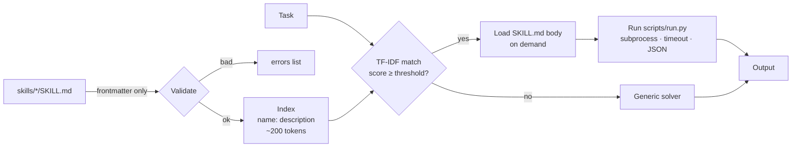

# skills-registry

A procedural-memory system for agents: know-how packaged as **skill bundles** (`SKILL.md` instructions + scripts + frontmatter metadata) that an agent discovers, matches by description, and loads **on demand**. Evaluated on 40 tasks with vs without skills (success rate and prompt tokens), plus 8 distractor tasks no skill covers.

> All numbers below come from `results/eval.json`. **No LLM is called.** The "agent" is a deterministic router + executor: it matches the task to a skill, loads that `SKILL.md`, and runs the bundled script. Token counts are regex counts of the prompt it would send.

## What it is
- `skills/<name>/SKILL.md` — YAML-style frontmatter (`name`, `description`, `tags`, `version`, `entrypoint`) and a numbered procedure. `skills/<name>/scripts/run.py` — the procedure as code (JSON in → JSON out).
- 8 bundled skills encoding house rules a generic agent would not know: `invoice-total` (8.25% tax on goods only, 2% early-pay discount, round once), `semver-bump` (pre-1.0 breaking → minor; `perf` → patch), `date-normalize` (2-digit-year pivot at 70), `branch-name` (stop words, ASCII, 30-char cut), `customer-dedupe` (gmail dot/+tag canonicalisation), `incident-severity` (on-call matrix), `shipping-weight` (dimensional weight ÷139), `phone-e164` (`00` prefix, invalid → null).
- `registry.py` — discovery, validation (kebab-case name = folder, description ≤200 chars, entrypoint must stay inside the bundle), frontmatter-only indexing, TF-IDF matching with a threshold, lazy body load with an audit counter, script execution in a subprocess (`python -I`, timeout, JSON I/O).
- `baselines.py` — generic solvers used when no skill is loaded.
- `evaluate.py` — three conditions on the same tasks, plus a threshold sweep.

## Why
Agents relearn the same procedures every session, or carry every procedure in the system prompt. Skills are the middle path: a short index is always in context; the full procedure is paid for only when a task needs it. The open questions are how much that saves, and how often lexical description matching picks the wrong skill.

## Architecture


## How it works
1. `Registry.discover()` reads only the frontmatter of each `SKILL.md` (stops at the closing `---`), validates it, and builds a TF-IDF index over name, description and tags.
2. The prompt holds the index (8 one-line entries, 200 tokens) instead of all bodies (1,517 tokens).
3. `select(query, threshold=0.15)` returns the top match if its cosine score clears the threshold; otherwise no skill loads and the agent falls back to a generic approach.
4. `load(name)` reads the full body into the prompt; `run(name, input)` executes the bundled script in isolated mode with a timeout.

## Results (no LLM; 40 scored tasks, 5 per skill, + 8 distractors; threshold 0.15 fixed before the run)
Gold outputs in `evals/tasks.json` were computed by hand from each procedure; the oracle condition reproduces all 40, which cross-checks gold against scripts.

| condition | success | mean prompt tokens | correct skill | wrong skill | no skill | distractor false loads |
|---|---|---|---|---|---|---|
| no_skills | 19/40 (0.475) | 74 | 0 | 0 | 40 | 0/8 |
| all_in_context (oracle routing) | 40/40 (1.000) | 1591 | 40 | 0 | 0 | 0/8 |
| registry | 33/40 (0.825) | 421 | 29 | 5 | 6 | 3/8 |

Threshold sweep (registry condition):

| threshold | success | correct | wrong | none | distractor false loads | mean tokens |
|---|---|---|---|---|---|---|
| 0.0 | 0.800 | 32 | 8 | 0 | 8 | 466 |
| 0.05 | 0.850 | 32 | 6 | 2 | 3 | 437 |
| 0.1 | 0.825 | 31 | 6 | 3 | 3 | 433 |
| 0.15 | 0.825 | 29 | 5 | 6 | 3 | 421 |
| 0.2 | 0.850 | 29 | 3 | 8 | 1 | 404 |
| 0.3 | 0.825 | 25 | 2 | 13 | 1 | 385 |
| 0.4 | 0.850 | 24 | 1 | 15 | 0 | 373 |

What the numbers say:
- **Skills on demand cost ~26% of the tokens of putting every procedure in the prompt** (421 vs 1,591 mean prompt tokens) and lift success from 0.475 to 0.825.
- **The gap to the oracle (0.825 vs 1.000) is all routing.** Lexical matching picked the right skill for 29/40 paraphrased tasks, a wrong one for 5, none for 6. Registry success (33) is higher than correct selections (29) because the generic fallback is right on some ordinary inputs.
- Worst family: `invoice-total`, 2/5 — queries like "How much does the client owe?" share almost no words with "invoice grand total … tax … discount".
- 3 of 8 distractors loaded a skill at 0.15 (e.g. "area of a circle" → `invoice-total`). Raising the threshold trades false loads for missed skills; no single threshold fixes both, which points to a semantic matcher.
- The no-skill baseline gap is **by construction**: half the cases exercise house rules the generic solver cannot know. The token and routing numbers are the non-trivial part.

Reproduce: `python -m skills_registry.evaluate`.

## Tests
55 tests (`pytest -q`): discovery and validation (missing description, bad name, entrypoint escaping the bundle, name/folder mismatch), frontmatter parsing that never reads the body, index-vs-body size, lazy loading, stemming, matching and threshold rejection, script execution + error + timeout handling, one test per eval task checking each script against the hand-computed gold (40), token ordering across conditions.

```bash
pip install pytest
python -m pytest -q
```

## Limits
- No LLM: a real agent may ignore a loaded procedure, follow it partly, or pick a skill differently from TF-IDF. Success here is an upper bound given the routing decision.
- Lexical TF-IDF with a toy stemmer. An embedding or LLM-based router would likely fix most of the 11 misroutes; not tested here.
- 40 tasks, 8 skills, single author: small, and the paraphrases were written by the same person who wrote the descriptions.
- Scripts run with `python -I` and a timeout, but there is no filesystem or network sandbox. Do not load untrusted skills.
- Tokens are regex counts, not BPE tokens.

## License
MIT
